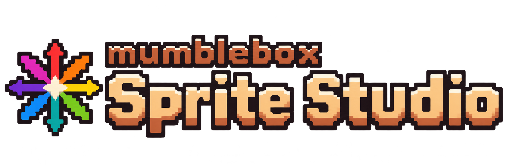

# mumblebox Sprite Studio

A local ComfyUI interface for image creation, turnaround sheets and reusable character or object references. Independent from The Foundry. **Development preview 0.1.0-dev.4 · Apache-2.0.**

## What works

- **Create Image:** P-H3 4-bit or 8-bit generation, annotated reference pictures, real model controls and plain-language help.
- **Turnaround:** cardinal, presentation and custom view requests; adjustable crop review; master plus separate PNG views and a recipe manifest.
- **Enhance:** native ComfyUI Qwen3.5 text generation, GPU first with CPU fallback, editable suggestions with Accept/Discard. Separate from the optional P-H3 prompt upsampler.
- **RefMods:** named reference collections, originals-preserving bundles and optional native H3 still encoding/decoding.
- **Gallery:** newest/oldest sorting, favorites, comparison, recipe reuse, recoverable individual/bulk Trash and Undo.
- Copper light/dark themes, scalable text, resource meters, SVG button icons and owned cache cleanup.

The GUI and four independent branches live in the same ComfyUI graph. Each action queues only its own branch. Models download on first use with checksum verification and resumable transfers. There is no external image-generation service or separate llama.cpp process in this extension.

## Get started

Follow [installation and rollback](docs/INSTALLATION.md), then open [the public starter workflow](workflows/Sprite%20Studio%20-%20Starter.json). Use the GUI to supply your own prompts and references. The starter contains no private inputs or generation history.

[Architecture](docs/ARCHITECTURE.md) · [Native Enhance research](docs/NATIVE-ENHANCE.md) · [Validation and limits](docs/VALIDATION.md) · [Third-party notices](THIRD-PARTY-NOTICES.md)

## Scope and limits

H3 animation, game sprites, translations and automatic Foundry integration are planned. They are not implemented features. Turnaround angles are requests, not measured camera calibration; review identity, proportions and hidden construction before using the exported views for 3D work. Mesh quality is not yet qualified.

This repository contains original extension code under [Apache-2.0](LICENSE). Models, ComfyUI and separately installed nodes retain their own licenses. In particular, P-H3/H3 weights are governed by their publishers' community terms; the extension license does not change those terms. No model weights, user references, Gallery contents or private runtime data are included.
